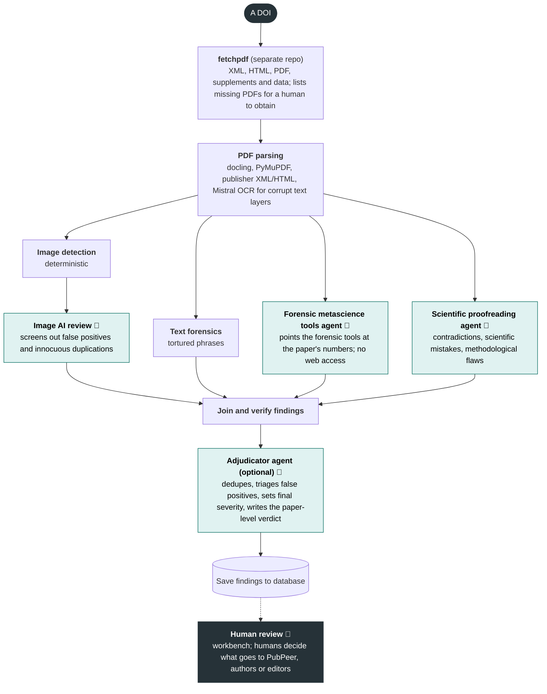

# Forensic Metascience AI Toolkit

## Install

```bash
pip install -e .
metascience preflight        # must print READY
git lfs install && git lfs pull   # evaluation corpora are LFS-tracked
```

Python 3.10+. Run `preflight` after installing. It names every dependency and
prints `READY` only when a run can do what it claims. Some missing packages
cause no error at all: a missing `statcheck`, for example, returns an empty
result that reads as "no statistics in this paper". The fatal checks also run
automatically before any paid run.

The plain install covers a full statistical review: reading PDFs, XML, HTML
and supplements, all the forensic tools, statcheck, both AI analysts plus
the adjudicator, `report.pdf` rendering, and the test runner
(`metascience-test`, with pytest). The one extra is `dev`, for working on the
toolkit itself (below).

`report.pdf` is rendered by `wkhtmltopdf` if it is installed, otherwise by
WeasyPrint, otherwise by `pandoc` with a PDF engine. WeasyPrint comes with
the install but needs the Pango library from your operating system, which pip
cannot install: `brew install pango` on macOS, `apt install
libpango-1.0-0 libpangoft2-1.0-0` on Debian/Ubuntu, or `conda install -c
conda-forge pango` in a conda environment (whose own GLib otherwise clashes
with the system Pango). If no renderer works, the run still finishes and
`run_meta.pdf_error` says why; every other output is unaffected.

**The findings database is optional.** Each finished run can be copied into
a local PostgreSQL database, which `db-push` and the review workbench read.
Without one, every result is still saved as files in the paper's
`forensic_review/` folder. `preflight` reports which applies and offers to set
one up. `metascience db-setup` walks through it: it checks that PostgreSQL is
installed and running and prints the commands for your system if not, creates
the database, applies the schema, and saves the URL to the repo `.env`. If you
don't want a database, `metascience db-setup --no-database` records that and
preflight stops asking.

Image analysis is not an extra. It is a separate package,
`metascience-observatory-image-analysis`. Install it after the toolkit and it
brings its own dependencies (OpenCV, docling, PyMuPDF, and EasyOCR through its
own `text-localization` extra). Without it, a review still runs and reports
that the figures were not examined.

| Extra | Packages | What it adds |
|---|---|---|
| `dev` | **pytest-xdist** (parallel workers behind `metascience-test`), **ruff** (linter) | Developing the toolkit. pytest and pytest-asyncio are base dependencies, so `metascience-test` runs on a plain install; without `dev` it installs pytest-xdist itself, or runs serially, and the ruff check skips. |


The AI review needs an agent CLI on PATH: [Claude Code](https://claude.ai/code)
(`--backend claude`), the Grok CLI (`--backend grok`), Codex (`--backend
codex`) or Google Antigravity's `agy` (`--backend antigravity`). Run
`metascience backends` to see which of these are installed on your machine
and which models each one offers.

## Quick start

Any run that includes a module requiring AI (either analyst, the
adjudicator, or the image module's AI screening) needs `--backend`: `claude`,
`codex`, `grok`, `antigravity` or `openrouter`. There is no default. You can
instead set `backend:` in a pipeline file. The `image_detect` and
`raw_data_only` pipelines call no model and need no backend. `metascience
models` shows which `--model` values each backend accepts. For
`antigravity` it asks `agy` for the live list your sign-in can use. The
examples use Claude Code.

**Review a paper with the full pipeline** (both analysts, image and text
tracks, adjudicator; paid):

```bash
metascience analyze paper.pdf --backend claude --budget-usd 30 # or a paper directory
```

**Run only the forensic metascience tools agent** (the statistical
consistency checks on the paper's numbers):

```bash
metascience run tools_only paper.pdf --backend claude   # = analyze paper.pdf --pipeline tools_only
```

**Run only the scientific proofreading agent** (contradictions,
methodological flaws, CONSORT flow):

```bash
metascience run proofreading_only paper.pdf --backend claude
```

A run with only one agent is labelled a partial review and gets its own
output folder; it never stands as the paper's review.

**Choose a backend** with `--backend` (required on `analyze`, `run` and
`batch`; a pipeline file's `backend:` also counts, and the `image_detect` and
`raw_data_only` pipelines call no model so need none). Each backend needs its
CLI installed and signed in. To see what this machine has, run:

```bash
metascience backends                    # every backend: installed?, version, default model, models
metascience backends --backend codex    # one backend
metascience backends --no-models        # only check what is installed
```

For each backend it prints whether the CLI is on PATH (for OpenRouter:
whether `OPENROUTER_API_KEY` is set), its version, the default `--model`,
and the models it offers. The model lists are live (`grok models`, `codex
debug models`, `agy models`, OpenRouter's public catalog), so they show
what your sign-in can use. Claude Code has no listing command, so its
aliases (`fable`, `opus`, `sonnet`, `haiku`) are shown instead. If a
default model is missing from your account's list, it is flagged; pass
`--model` explicitly. It costs nothing (`--all` prints all of OpenRouter's
models, `--json` for scripts).

```bash
metascience analyze paper.pdf --backend claude        # Claude Code (model opus)
metascience analyze paper.pdf --backend codex         # Codex CLI (model gpt-5.6-sol)
metascience analyze paper.pdf --backend grok          # Grok CLI (model grok-4.6)
metascience analyze paper.pdf --backend openrouter    # our own agent loop; needs OPENROUTER_API_KEY
metascience run tools_only paper.pdf --backend grok --model grok-4.6
```

**A whole corpus:**

```bash
metascience batch corpus/ --backend claude --dry-run                   # free: plan and cost estimate
metascience batch corpus/ --backend claude --budget-usd 30 --workers 10 # resumable; finished papers are skipped
```

**Free, offline checks** (no AI):

```bash
metascience benchmark                      # synthetic papers; fails if a clean paper is accused
metascience debit 0.35 0.48 100
metascience check-ci 1.42 1.08 1.87 --measure HR
metascience required-n two_sample_t 0.5    # -> 64/group
metascience tool list                      # every registered tool
metascience tool run grim_check --json '{"mean": 5.51, "n": 30, "decimals": 2, "data_type": "likert"}'
```

`metascience tool run` goes through the same guards the AI sees, so it is
stricter than the bare `grim` command: without `data_type` and `decimals` it
refuses, and the call above says `suspicious`, not `impossible`, because the
scale bounds and integer data are assumed rather than stated by a paper.
Ambiguous input is refused, not guessed: `48.90 (14.46)` could be a mean and
SD, a count and percentage, or an estimate and CI, and `metascience
parse-cells` says so.

`batch` skips papers with *no full text* (nothing readable), with no flag to override it.
A paper whose cited supplementary material is not present is *analysed anyway*, with a
warning and a limitation in its report: a statistic in an absent file can read as one the
authors never reported, so "not reported" findings must be read against it.
`--ok-if-supplementary-missing` is accepted for old scripts and has no effect.

A paper directory may hold publisher XML, HTML, the PDF, `body.md` and
supplements. The analysts read XML first, then the PDF, then `body.md`: the XML
is the only source that keeps table structure (on one clinical Table 1, 86
usable cells from the XML against 7 from the PDF).

Recent measured cost: about $2-3 per paper on Claude Sonnet. Only the Claude
backend honours `--budget-usd`. The usage guard pauses a Claude, Codex or Antigravity run
when the 5-hour window reaches 90% and stops it when the weekly gauge is
at/over 97%; pass `--ignore-weekly-limit` when extra credits will cover it,
or `--no-usage-guard` to turn it off.

## How it works

Modules run concurrently; the adjudicator finalises. The models never do the
arithmetic: validated tools do (or, for the proofreading agent, captured
script output).



Papers are fetched by [fetchpdf](https://github.com/The-Metascience-Observatory/fetchpdf).

- **Tools agent** (58 tools are callable by the tool expert; no internet, no
  code): reads the paper, types every table cell, and checks each statistic
  with the matching tool.
- **Scientific proofreading agent** (internet on, sandboxed Python): patient
  flow, internal contradictions, and facts it looks up, with sources recorded.
- **Image detection** (deterministic) and **AI image review**: duplicated or
  manipulated figure panels, from the separately distributed image analysis
  package. Only screened findings reach the adjudicator. Without that package
  the image channel says the figures were NOT examined; nothing else changes.
- **Text forensics** (tortured phrases) and the opt-in **raw-data** module:
  deterministic, quarantined signals that never become the headline.
- **Adjudicator**: dedupes, verifies quotes, may re-run tools, and assigns the
  final severities and the paper verdict.

Each module is a folder in `src/metascience_agent/modules/` (definition,
code and, for agents, its prompt); each tool family is a folder in
`tool_specs/`. The two tools no agent can call, `analyze_paper_images` and
`detect_tortured_phrases`, are run by the deterministic tracks instead. See
[docs/specs/modules.md](docs/specs/modules.md).

**The tool sandbox.** An early run had the model write its own scipy t-tests
in `/tmp`, bypassing every guard; the report looked identical. So the Claude
analysts get only:

```python
BUILTIN_TOOLS = ["Read"]
DENIED_TOOLS = [
    "Bash", "Edit", "Write", "NotebookEdit", "WebFetch", "WebSearch", "Task", "ToolSearch",
]
```

`--allowedTools` does not restrict anything under `bypassPermissions`; only
`--tools` plus `--disallowedTools` does. Grok and Codex sandboxes are weaker,
and `run_meta.json` says so. Antigravity runs under a per-run `HOME`
whose custom agent lists its built-in tools explicitly (`view_file`,
`finish`, plus the web pair for the science agent); a shell, writes and
subagents are not on it, and permission rules deny them as well.

## Pipelines

A pipeline chooses which modules run. `full` is the default review.

```bash
metascience pipeline list
metascience run tools_grim paper.pdf --backend claude   # = analyze paper.pdf --pipeline tools_grim
```

| Pipeline | Runs |
|---|---|
| `full` | tools agent + scientific proofreading agent + image detection and AI review + text forensics + adjudicator |
| `no_adjudication` | as `full`, severities left provisional |
| `tools_only`, `tools_grim` | the tools agent alone, with all tools or GRIM only |
| `proofreading_only` | the scientific proofreading agent alone |
| `image_only`, `image_detect` | image detection with or without AI review (no LLM analysts; needs the image analysis package) |
| `raw_data_only`, `full_raw_data` | the copy-paste detector over the paper's spreadsheets, alone or added to `full` |
| `full_brief`, `full_skill` | `full` with a different tool-access mode (experiments) |

Write your own YAML (`metascience pipeline validate my.yaml`). Only a pipeline
with both analysts, the full toolset and the adjudicator counts as a paper's
review; any other run gets its own output folder and is labelled partial. See
[docs/specs/pipeline_config.md](docs/specs/pipeline_config.md).

## What a review produces

Outputs go to `forensic_review/` inside a paper directory, or to
`<paper>_forensic_review_<model>_v<version>/` beside a PDF (`-o` overrides).

- `report.md` (and `report.pdf`): rendered from the findings document, headline
  first, with what could NOT be checked and a provenance stamp.
- `findings.v2.json`: every finding with its id, producer, technique, final 1-9
  severity, tool verdict, quotes and a reproduction command. Discarded findings
  are kept with their disposition.
- `adjudication.json`: the adjudicator's raw output.
- `run_meta.json`: cost, tokens, timing, versions and prompt hashes.
- `analysis_code/`: every script the proofreading agent ran.
- `prompt.*.md`, `toolcalls.*.json`, `messages.*.json`: per agent, what it was
  sent and every tool call it made.
- `sandbox_audit.json`: **read this one.** It says whether anything ran outside
  the validated tool surface.
- A `_bundle/viewer.html` that opens offline (`metascience bundle`).

Runs from the old serial pipeline (removed in v1.27.0) use `report.json`,
`findings.json`, `toolcalls.stage{1,2}.json` and `messages.stage{1,2}.json`;
every reader still opens them.

## Severity

Every tool returns `impossible`, `highly_suspicious`, `suspicious`,
`indeterminate` or `consistent`. **`indeterminate` is the default under
uncertainty**: a tool whose preconditions are unknown declines to judge rather
than guess. `impossible` is a claim about arithmetic, not people: three printed
numbers cannot all be true, which says nothing about which is wrong or why.
Before reading anything into one, see
[docs/GRIM_CONTEXT_DEPENDENCY.md](docs/GRIM_CONTEXT_DEPENDENCY.md) (nineteen
innocent mechanisms). The adjudicator then gives each finding a final severity
on a 1-9 ladder, under clamps enforced in code.

## Reviewing results: the workbench

A local web app for reviewing many papers and image matches:

```bash
python -m metascience_agent.workbench.service --migrate
cd webapp && npm install && npm run dev      # http://localhost:3100
```

Findings on the left, the PDF on the right; image matches have their own queue
with side-by-side, blink and overlay comparison. Decisions are stored locally
and synced to the shared database. Nothing is published from it. See
[webapp/README.md](webapp/README.md) and
[docs/workbench_storage.md](docs/workbench_storage.md).

## Validation

| Check | Reference | Result |
|---|---|---|
| Power analysis | R `pwr` | 7/7 exact |
| Estimate/CI recovery | R | agreement to 1e-12 |
| SPRITE | `rsprite2` | 100% at 2 dp; 92.1% overall |
| DEBIT | `scrutiny` | 0 false accusations over 28,720 cells |

```bash
metascience eval --backend claude --model sonnet   # 4 fixtures with gold findings; costs money
metascience eval --skip-analysis                   # rescore saved runs; still calls the judge
```

The fixtures, papers and saved runs are in
[benchmarks/paper_reviews/](benchmarks/paper_reviews/README.md); every benchmark
is listed in [benchmarks/README.md](benchmarks/README.md).

`eval/ground_truth/` holds 78 papers (30 adjudicated fraud, 48 controls) with
how each was established.

`--skip-analysis` is not free: it reuses an existing analysis but still calls
the LLM judge, and on a fixture with no saved run it refuses rather than
silently running the paid pipeline.

## Limitations

- **Extraction is the binding constraint.** The arithmetic is exact, but table
  cells lose their row and column addresses: on one JAMA table, 26% of
  `estimate (95% CI)` pairs were broken while no number was missing.
- **Font corruption.** About a third of PDFs have broken character maps (`±`
  read as `6`, `=` as `5`, a minus sign lost). The run detects and warns; it
  does not repair.
- **Figures are mostly invisible** to the statistical review.
- **Preconditions are usually unstated.** A wrong scale bound inverts a check
  rather than weakening it.
- **An impossible number is not proof of fabrication.** That step needs
  evidence this toolkit does not have.

## Python API

```python
from metascience_agent.agent import analyze_paper_sync
from metascience_agent.tools import grim_test

result = analyze_paper_sync("paper_dir/", mode="parallel", budget_usd=8.0)
print(grim_test(mean=5.51, n=30, scale_min=1, scale_max=7)["consistent"])  # False
```

## Development

```bash
pip install -e '.[dev]'        # pytest-xdist and ruff
metascience-test -q            # Python suite, parallel
metascience-test --stack -q    # everything local: Python, TypeScript, web, lint
```

The suite is free and offline. pytest comes with the plain install, so
`metascience-test` runs without the `dev` extra: it installs pytest-xdist
itself (or runs serially if it cannot), and the ruff check skips with a
message. The stack's lint step is the toolkit's own `metascience lint-inert`,
not ruff. Ruff is configured to check only syntax errors and pyflakes rules
(unused imports and variables, undefined names); `tests/test_ruff_errors.py`
keeps `src/` at zero. Run `ruff check src/` to see them, and do not run
`ruff --fix`: it has deleted imports here that other modules re-export. See [CLAUDE.md](CLAUDE.md) for the environment,
conventions and invariants, and [CHANGELOG.md](CHANGELOG.md) for what each
version changed.

## Related packages

- [`copy_paste_detector/`](copy_paste_detector/README.md) (in this
  repository): the raw-data copy-paste detector, also standalone; evaluation
  protocol in [benchmarks/copy_paste/README.md](benchmarks/copy_paste/README.md).
- **Image analysis** (`metascience_observatory_image_analysis`) is a separate,
  privately distributed package that builds on this toolkit. Installed after
  it (`pip install -e ../metascience-observatory-image-analysis`), it adds the
  image track, the `metascience image-*` commands and the workbench image
  queue. The toolkit runs without it.

## License

**Free for noncommercial use.** Researchers, universities, nonprofits,
journalists, government bodies and individuals may use, modify and share
this toolkit for noncommercial purposes. Two limits apply:

- **No commercial use.** You may not sell it, offer paid services built on
  it, or use it inside a for-profit company. For a commercial license,
  email dan@metascienceobservatory.org.
- **Less than 500 papers.** Before analyzing more than 500 papers in
  total across your organization, email dan@metascienceobservatory.org for
 permission. If you are using it for bulk analysis, the Metascience Observatory would like to be involved.  

The full terms are the [PolyForm Noncommercial License 1.0.0](https://polyformproject.org/licenses/noncommercial/1.0.0)
plus the additional terms in [LICENSE](LICENSE); the LICENSE file is what
governs.
